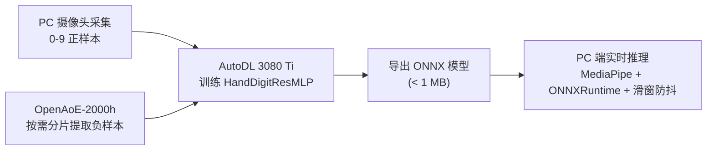

# 手势数字识别（Chinese Hand Digit Recognition）

基于 **MediaPipe 21 关键点 + 88 维几何不变特征 + 轻量残差网络（`HandDigitResMLP`）** 的中国单手数字（`0`–`9`）实时识别系统。  
结合魔搭社区蚂蚁集团开源的第一人称数据集 **`inclusionAI/OpenAoE-2000h`** 作为困难负样本，在 **AutoDL RTX 3080 Ti** 上数分钟即可完成训练，导出 `< 1 MB` 的 **ONNX** 模型，在普通 **PC 电脑（纯 CPU 即可）** 稳定运行 **30–60 FPS**。

> 详细算法原理、特征数学定义与实验分析请查阅：[docs/TECHNICAL_DESIGN.md](docs/TECHNICAL_DESIGN.md)

---

## 核心特性与实测指标

* **专为中国单手数字 0–9 优化**：显式提取 14 维指关节弯曲/张开夹角与 9 维指尖距离特征，精准区分 `6`、`7`、`8`、`9`、`0` 等易混手势。
* **背景与肤色无关**：归一化关键点几何特征天然免疫房间背景、光照与衣物变化，几千帧即可泛化。
* **超低日常误触发**：按需分片拉取 `OpenAoE-2000h` 第一人称日常手部操作作为 `Class 10 (Other)` 负样本，自动删大视频防爆盘。
* **实测表现（AutoDL RTX 3080 Ti）**：
  * 测试集准确率：**`99.85%`**（`Test Macro-F1: 0.9982`）
  * 非数字手势误触发率（FPR on Other/OpenAoE）：**`0.21%`**
  * 模型体积：**`< 1 MB`**（ONNX），PC 端推理 **`< 0.3 ms/帧`**

---

## 系统流程



---

## 目录结构

```text
hand/
├── README.md                              # 项目说明与快速上手指南
├── requirements.txt                       # 锁定兼容版本的依赖清单
├── configs/
│   └── config.yaml                        # 全局配置（类别、特征、训练超参、防抖阈值）
├── docs/
│   └── TECHNICAL_DESIGN.md                # 详细技术设计文档
├── src/
│   ├── features.py                        # 88 维几何不变特征提取（训练与推理共用）
│   ├── model.py                           # HandDigitResMLP 轻量残差分类器
│   ├── dataset.py                         # 关键点空间在线数据增强
│   ├── hand_extractor.py                  # MediaPipe 21 关键点与可视化封装
│   └── smoother.py                        # 滑动窗口投票 + 置信度滞回防抖
├── scripts/
│   ├── 01_collect_pc_data.py              # [PC] 交互式摄像头数据采集工具
│   ├── 02_fetch_openaoe_negatives.py      # [AutoDL] 按需拉取 OpenAoE-2000h 负样本
│   ├── 03_train.py                        # [AutoDL] AMP 训练、混淆矩阵与 FPR 评估
│   ├── 04_export_onnx.py                  # [AutoDL] 导出 ONNX 并校验数值一致性
│   └── 05_realtime_pc_demo.py             # [PC] 纯 ONNXRuntime 实时摄像头识别 Demo
├── data/processed/                        # 压缩关键点数据集 (.npz)
└── checkpoints/                           # 训练权重 (.pt) 与部署模型 (.onnx)
```

---

## 环境安装

> **版本避坑提示**：本工程已锁定 `mediapipe<0.10.30`、`onnx<1.18.0` 与 `protobuf<5`，请严格按以下命令安装以避免接口移除或 protobuf 冲突。

### 1. 本地 PC 环境（采集数据 & 实时推理，无需 PyTorch）

```powershell
# 建议使用 Python 3.10–3.12 创建虚拟环境
python -m venv .venv
.\.venv\Scripts\Activate.ps1

# 安装 PC 端轻量依赖（激活 .venv 后请直接使用 python，不要用 py -3）
python -m pip install opencv-python "mediapipe==0.10.21" numpy PyYAML onnxruntime "protobuf<5"
```

### 2. AutoDL RTX 3080 Ti 训练环境（镜像已自带 PyTorch）

```bash
cd /root/autodl-tmp/hand
pip install "mediapipe==0.10.21" modelscope "onnx==1.17.0" onnxruntime scikit-learn opencv-python-headless PyYAML tqdm
```

---

## 快速上手（4 步完整流程）

### 第 1 步：【PC 端】采集中国单手数字 0–9

```powershell
python scripts/01_collect_pc_data.py --output data/processed/pc_collected.npz --flip
```

* **按键说明**：`0`–`9` 切换数字类别 | `o` 切换为 `Other (10)` | `空格` 开始/暂停连拍 | `s` 保存 | `q` 保存退出。
* **建议采集量**：每个数字采集 **300–800 帧**，录制时缓慢转动手腕、拉远拉近、交替左右手。
* 采集完成后将 `data/processed/pc_collected.npz`（约 1–2 MB）上传至 AutoDL：
  ```powershell
  scp -P <PORT> data/processed/pc_collected.npz root@<HOST>:/root/autodl-tmp/hand/data/processed/
  ```

---

### 第 2 步：【AutoDL 端】按需拉取 `OpenAoE-2000h` 日常负样本

```bash
cd /root/autodl-tmp/hand
python scripts/02_fetch_openaoe_negatives.py \
    --cache-dir /root/autodl-tmp/openaoe_cache \
    --output data/processed/openaoe_negatives.npz \
    --max-videos 30 \
    --max-samples 8000 \
    --sample-stride 15
```

* 脚本逐个拉取视频分片、抽帧提取关键点并**立即删除原视频**，防止 AutoDL 50 GB 数据盘爆盘。
* 若已有本地第一人称视频目录，可改用 `--local-video-dir /path/to/videos`。

---

### 第 3 步：【AutoDL 端】训练模型并导出 ONNX

```bash
# 训练（自动合并 data/processed/*.npz，3080 Ti 约 1–3 分钟完成）
python scripts/03_train.py --config configs/config.yaml

# 导出 ONNX 并自动校验 PyTorch vs ONNXRuntime 误差 (< 1e-4)
python scripts/04_export_onnx.py --config configs/config.yaml
```

---

### 第 4 步：【PC 端】拉回 ONNX 实时识别

```powershell
mkdir checkpoints -Force
scp -P <PORT> root@<HOST>:/root/autodl-tmp/hand/checkpoints/hand_digit_cls.onnx checkpoints/

# 启动摄像头实时识别（按 q / ESC 退出）
python scripts/05_realtime_pc_demo.py --config configs/config.yaml --flip
```

---

## 关键配置说明（`configs/config.yaml`）

| 配置项 | 默认值 | 说明 |
| :--- | :--- | :--- |
| `train.epochs` / `batch_size` | `80` / `256` | 最大训练轮数与批大小（支持 `early_stop_patience: 15`） |
| `train.label_smoothing` | `0.05` | 标签平滑，抑制过拟合 |
| `inference.confidence_threshold` | `0.75` | 单帧置信度门槛，低于此值视为非数字 `Other` |
| `inference.smooth_window` | `7` | 视频流滑窗防抖长度（帧） |
| `inference.min_consensus` | `5` | 窗口内至少 5 帧一致才刷新稳定输出 |

---

## 常见问题排查（FAQ）

1. **`AttributeError: module 'mediapipe' has no attribute 'solutions'`**  
   安装了 `mediapipe>=0.10.30`。执行 `pip install "mediapipe==0.10.21"` 即可解决。
2. **`ImportError: cannot import name 'runtime_version' from 'google.protobuf'`**  
   `onnx>=1.18.0` 与 `protobuf 4.x` 冲突。执行 `pip install "onnx==1.17.0"` 即可解决。
3. **Windows 激活 `.venv` 后报 `ModuleNotFoundError: No module named 'cv2'`**  
   不要使用 `py -3`（会绕过 `.venv` 调用全局 Python），请直接使用 `python`。
4. **实测某个数字在特定角度偶尔识别不稳**  
   重新运行 `01_collect_pc_data.py` 针对该数字和角度补录 3–5 秒（脚本会自动追加到原 `.npz`），重新训练 2 分钟即可生效。
