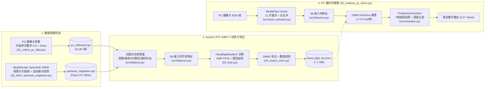

# 手势数字识别系统 — 详细技术文档

> **项目名称**：`chinese-hand-digit`  
> **技术路线**：两阶段解耦架构（MediaPipe 21 关键点提取 + 88 维几何不变特征 + 轻量残差网络 `HandDigitResMLP` + 时序滑窗防抖）  
> **训练环境**：AutoDL 云 GPU（NVIDIA GeForce RTX 3080 Ti 12GB）  
> **部署环境**：PC 端（Windows / Linux，ONNX Runtime CPU/GPU 实时推理，30–60 FPS）

---

## 1. 项目背景与设计目标

中国单手数字手势（`0`–`9`）与欧美/ASL 手势存在显著差异，尤其是 `6`（拇指+小指伸展）、`7`（三指捏合）、`8`（拇指+食指成枪形）、`9`（食指勾曲）及 `0`（五指拢起）。在真实摄像头/第一人称视角下，手势识别面临三大核心痛点：

1. **背景、光照与肤色变化大**：端到端纯视觉模型（如 YOLO）在小样本下极易过拟合特定房间背景。
2. **日常手部动作误触发高**：自然抓握、指物、敲键盘等非数字手势很容易被 10 分类模型强行归类为某个数字。
3. **PC 端轻量化实时运行**：目标端为普通 PC（可能无独立显卡），要求低延迟、低依赖、无需部署庞大 PyTorch 环境。

因此，本工程采用**两阶段解耦架构（方案 A）**，并引入蚂蚁集团在魔搭社区开源的第一人称具身操作数据集 **`inclusionAI/OpenAoE-2000h`** 作为真实日常手部动作的**困难负样本库（Class 10: `Other`）**，在保证高识别准确率的同时将日常误触发率压低至 `< 0.3%`。

---

## 2. 系统总体架构

### 2.1 端到端数据流与推理流



### 2.2 架构选型对比（当前方案 vs 端到端 YOLO）

| 评估维度 | 当前方案（关键点 + ResMLP） | 端到端 YOLO（如 YOLO11n/s） |
| :--- | :--- | :--- |
| **样本需求与泛化** | 极低（几千帧即可跨背景/跨人泛化） | 较高（需数万张多场景带框标注图） |
| **PC 纯 CPU 性能** | 30–60 FPS（分类器 `< 0.3 ms`） | 约 10–25 FPS（640×640） |
| **动态手势扩展** | 极易（直接扩展为时序关键点序列） | 困难（单帧静态检测器） |
| **多人同框与强遮挡** | 受上游 MediaPipe 检出质量限制 | 一次前向同时检出多手，抗部分遮挡更强 |
| **部署依赖** | MediaPipe + ONNX Runtime | 单一 ONNX 文件 |

---

## 3. 数据体系与存储规范

### 3.1 类别体系（11 分类）

标签定义于 `configs/config.yaml`：
* `0`–`9`：中国单手数字 `0` 至 `9`。
* `10`：`Other`（非数字日常手势），用于显式建模背景手部动作，阻断误触发。

### 3.2 存储格式规范（`.npz`）

所有数据均不保存冗余原始视频帧，仅持久化压缩后的关键点张量，单万条样本仅占用约 `2 MB` 磁盘空间：

| 字段名 | Shape | Dtype | 说明 |
| :--- | :--- | :--- | :--- |
| `landmarks` | `(N, 21, 3)` | `float32` | MediaPipe 输出的 21 个手部关键点归一化坐标 `(x, y, z)` |
| `handedness` | `(N,)` | `float32` | 左右手标志（`1.0` = Right，`0.0` = Left） |
| `labels` | `(N,)` | `int64` | 类别 ID（`0`–`10`） |

### 3.3 `OpenAoE-2000h` 困难负样本拉取策略

`inclusionAI/OpenAoE-2000h` 全量包含 2,000 小时第一人称操作视频（TB 级），而 AutoDL 默认数据盘（`/root/autodl-tmp`）为 50 GB。为此，`scripts/02_fetch_openaoe_negatives.py` 实现了**流式分片抽样与即用即删机制**：

1. 通过 `modelscope.hub.api.HubApi.get_dataset_files` 仅拉取远端文件目录树，不触发全量下载。
2. 按 `--max-videos` 逐个调用 `dataset_file_download` 下载单个视频到 `/root/autodl-tmp/openaoe_cache`。
3. 按 `--sample-stride`（默认 15，30fps 下约每秒 2 帧）用 MediaPipe 提取双手关键点并打标为 `10`。
4. 在 `finally` 块中**立即删除已处理的原始大视频**（除非显式传入 `--keep-videos`），确保磁盘占用始终维持在几百 MB 以内。

---

## 4. 核心算法设计

### 4.1 88 维几何不变特征工程（`src/features.py`）

为消除摄像头距离、手掌大小、画面位置带来的干扰，并强化对中国单手数字关键部位的辨识力，特征提取流程严格执行以下 4 步（训练与 PC 推理 100% 共用同一份纯 NumPy 代码）：

1. **平移与尺度归一化（63 维）**：
   以手腕（点 `0`）为坐标原点，以手腕到中指根部（点 `9`，`MIDDLE_MCP`）的欧氏距离 `palm_scale` 进行尺度归一化：
   $$\hat{p}_i = \frac{p_i - p_0}{\|p_9 - p_0\|_2}, \quad i \in \{0, \dots, 20\}$$
2. **指关节弯曲角与指间张角（14 维）**：
   * **10 个指关节弯曲角余弦**：覆盖 5 根手指的近端/远端指关节三元组，直接区分 `9`（食指弯曲成钩）与 `1`（食指伸直）。
   * **4 个相邻手指张角余弦**：计算相邻两指 `MCP → TIP` 向量的夹角余弦，精准刻画 `8`（拇指与食指张开）和 `6`（拇指与小指张开）。
3. **指尖关键距离特征（9 维）**：
   * 5 个指尖到手腕的归一化距离（刻画手指伸展程度）。
   * 拇指尖（点 `4`）到其余 4 个指尖的归一化距离（对 `7` 的三指捏合、`0` 的五指合拢极度敏感）。
4. **手掌朝向与左右手元特征（2 维）**：
   * 左右手标志 `handedness`（1 维）。
   * 掌心法向量 $z$ 分量：由 $\vec{v}_{0\to 5} \times \vec{v}_{0\to 17}$ 单位化后的 $z$ 轴分量构成，用于区分手心朝向与手背朝向。

### 4.2 关键点空间在线数据增强（`src/dataset.py`）

所有增强均在**原始 `(21, 3)` 关键点空间**实时执行，随后再计算 88 维特征，保证坐标、角度与距离之间严格几何自洽：

| 增强策略 | 参数范围 | 模拟真实场景 |
| :--- | :--- | :--- |
| 随机水平镜像 | `p = 0.5`（同步翻转 `handedness`） | 中国数字 0–9 左右手语义对称 |
| 面内随机旋转（绕 Z 轴） | `[-25°, +25°]` | 手腕歪斜、第一人称头部倾斜 |
| 3D 视角微扰（绕 Y 轴） | `[-12°, +12°]` | 侧手拍摄角度变化 |
| 各向异性缩放 | `[0.90, 1.10]` | 不同人手型胖瘦、广角镜头畸变 |
| 高斯坐标抖动 | `σ ∈ [0, 0.025] × palm_scale` | MediaPipe 关键点检出抖动与运动模糊 |
| 局部遮挡扰动 | `p = 0.2`，随机扰动 1–2 个关节 | 手指前后遮挡引起的局部跳点 |

### 4.3 模型结构：`HandDigitResMLP`（`src/model.py`）

```text
Input (B, 88)
  └─► InputProj: Linear(88 → 256) → LayerNorm → SiLU
  └─► ResMLPBlock 1: 256 → 256 (Linear-LN-SiLU-Dropout(0.25)-Linear-LN + Shortcut → SiLU)
  └─► ResMLPBlock 2: 256 → 256 (Residual)
  └─► ResMLPBlock 3: 256 → 128 (Projected Residual)
  └─► Head: Dropout(0.125) → Linear(128 → 11)
Output Logits (B, 11)
```

* **参数量**：约 `0.25M`，导出 FP32 ONNX 体积 `< 1 MB`。
* **选择 LayerNorm 而非 BatchNorm**：避免小 batch 或推理单帧（`batch_size=1`）下的统计量偏移。

### 4.4 训练与防不平衡策略（`scripts/03_train.py`）

* **分层切分**：按 `75% / 15% / 10%` 分层划分 Train / Val / Test。
* **平滑逆频率类别权重**：当 `OpenAoE-2000h` 负样本远多于单个数字类别时，自动按 $w_c \propto 1 / \sqrt{N_c + 1}$ 加权交叉熵，避免模型偏向预测 `Other`。
* **正则化与优化**：`AdamW`（`lr=1e-3, weight_decay=1e-2`）+ `CosineAnnealingLR` + `Label Smoothing (0.05)` + `AMP FP16` + `Early Stopping (patience=15)`。

### 4.5 视频流时序防抖（`src/smoother.py`）

针对视频流中手势切换瞬间的过渡帧抖动，采用 `PredictionSmoother`：
* 维护长度为 `7` 帧的滑动窗口；
* 单帧最高置信度 `< 0.75` 时自动记为 `Other (10)`；
* 仅当窗口内同一类别出现次数 `≥ 5` 帧时才更新稳定输出状态，大幅消除闪烁与瞬时误报。

---

## 5. 实验结果与性能评估

### 5.1 训练数据构成
* **自采 PC 正样本 + 负样本（`pc_collected.npz`）**：共 `9,145` 帧（`0`: 382, `1`: 618, `2`: 600, `3`: 879, `4`: 990, `5`: 834, `6`: 931, `7`: 849, `8`: 1049, `9`: 997, `Other`: 1016）。
* **`OpenAoE-2000h` 负样本（`openaoe_negatives.npz`）**：约 `3,800+` 帧真实第一人称日常操作手部样本。
* **总样本规模**：约 `12,960` 帧（测试集 `1,296` 帧）。

### 5.2 AutoDL RTX 3080 Ti 实测指标

模型在第 `46` 轮达到验证集 `Val Macro-F1 = 1.0000`，并在第 `61` 轮触发早停。测试集最终评估结果如下：

| 类别 | Precision | Recall | F1-Score | Support |
| :--- | :---: | :---: | :---: | :---: |
| `0` | 1.0000 | 1.0000 | 1.0000 | 38 |
| `1` | 1.0000 | 0.9839 | 0.9919 | 62 |
| `2` | 1.0000 | 1.0000 | 1.0000 | 60 |
| `3` | 1.0000 | 1.0000 | 1.0000 | 88 |
| `4` | 1.0000 | 1.0000 | 1.0000 | 99 |
| `5` | 0.9881 | 1.0000 | 0.9940 | 83 |
| `6` | 1.0000 | 1.0000 | 1.0000 | 93 |
| `7` | 1.0000 | 1.0000 | 1.0000 | 85 |
| `8` | 1.0000 | 1.0000 | 1.0000 | 105 |
| `9` | 0.9901 | 1.0000 | 0.9950 | 100 |
| `Other` | 1.0000 | 0.9979 | 0.9990 | 483 |
| **Overall Accuracy** | — | — | **0.9985** | **1296** |
| **Macro Avg** | **0.9980** | **0.9983** | **0.9982** | **1296** |

* **核心误报率指标（FPR on Other/OpenAoE）**：**`0.21%`**（483 个日常非数字样本中仅 1 个被误触发为 `5`）。
* **错误案例归因**：全部 1,296 条测试样本仅出错 2 条（1 条 `1 → 9` 为食指微弯边界案例；1 条 `Other → 5` 为日常张开手掌动作）。
* **ONNX 导出精度校验**：PyTorch 与 ONNX Runtime 最大绝对误差 `< 1e-4`。

---

## 6. 工程踩坑记录与依赖兼容规范

在 AutoDL Linux 环境与 Windows PC 环境联调过程中，已沉淀以下关键避坑规范（均已固化至 `requirements.txt`）：

1. **MediaPipe 0.10.30+ 移除 `mp.solutions`**：
   新版 MediaPipe 移除了内置 `mp.solutions.hands` 接口，改为需外网下载 `.task` 文件的 Tasks API。**解决方案**：锁定 `mediapipe>=0.10.14,<0.10.30`（推荐 `0.10.21`）。
2. **`onnx 1.18+` 与 `protobuf 4.x` 冲突**：
   MediaPipe 0.10.21 依赖 `protobuf 4.x`，而 `onnx 1.18+` 需 `protobuf 5+/6+`（导致 `ImportError: cannot import name 'runtime_version'`）。**解决方案**：锁定 `onnx>=1.15.0,<1.18.0`（推荐 `1.17.0`），本地装 `onnxruntime` 时附加 `"protobuf<5"`。
3. **Windows `.venv` 虚拟环境与 `py -3` 启动器冲突**：
   在已激活 `(.venv)` 的 PowerShell 中，`py -3` 仍会调用系统全局 Python。**解决方案**：激活虚拟环境后统一直接使用 `python`。
4. **AutoDL 存储空间管理**：
   系统盘仅 30 GB，所有代码、缓存与权重必须存放在 `/root/autodl-tmp/` 数据盘下。

---

## 7. 局限性与后续演进路线

1. **支持中国手势“10”及动态手势**：
   将单帧 88 维特征扩展为 `T=16` 帧滑窗序列 `(B, 16, 88)`，分类器升级为轻量 `1D-CNN` 或 `GRU`，即可识别握拳晃动、双指交叉等动态手势。
2. **Stage 1 替换与去 MediaPipe 化**：
   若未来在强遮挡、远距离或戴手套场景下遇到 MediaPipe 漏检，可将 Stage 1 替换为基于 `OpenAoE-2000h` MANO 投影微调的 **`YOLO11-Pose`（手部关键点版）**，Stage 2 直接复用当前 88 维几何分类器。
3. **跨人/跨设备严格泛化评估**：
   当前离线测试集为帧级分层切分，后续若扩展多人数据集，建议升级为按**采集者/视频片段分组切分（GroupKFold）**以更严格地衡量跨人泛化能力。
